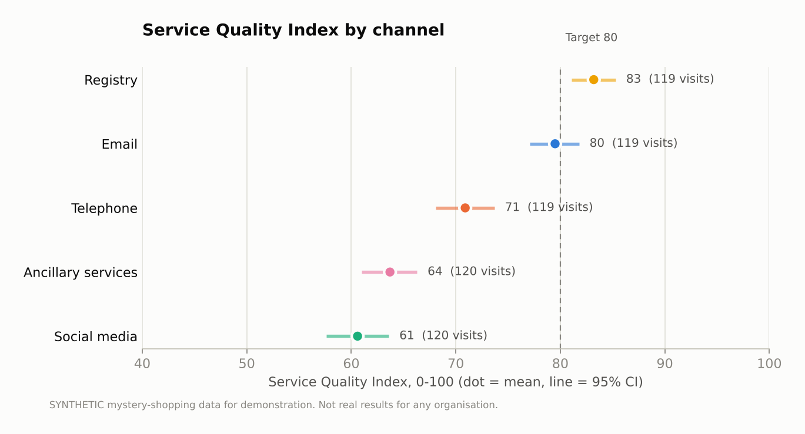
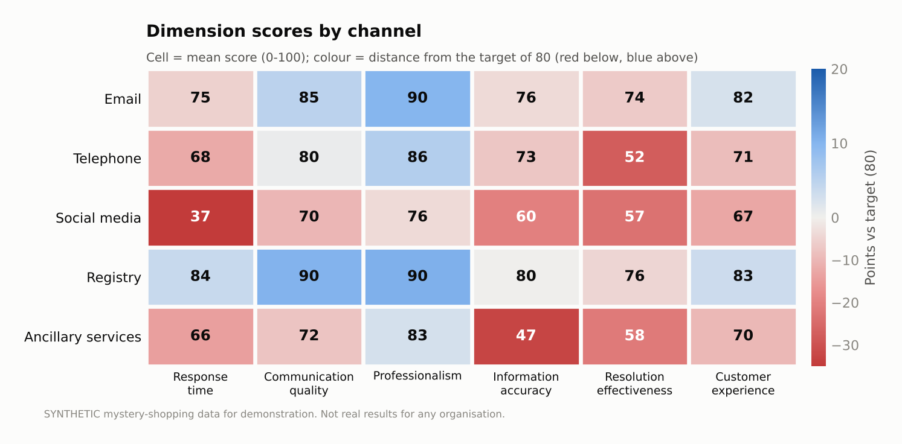
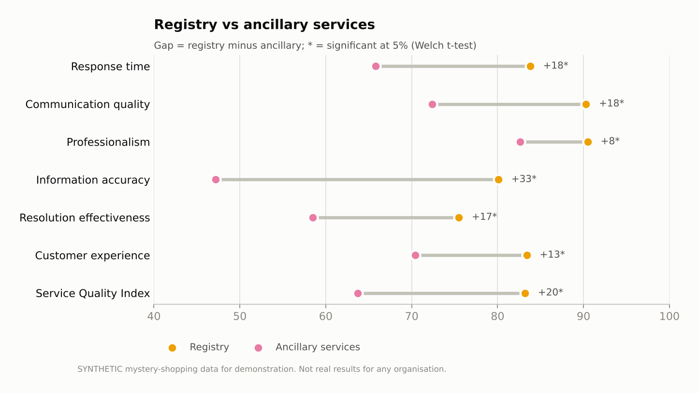
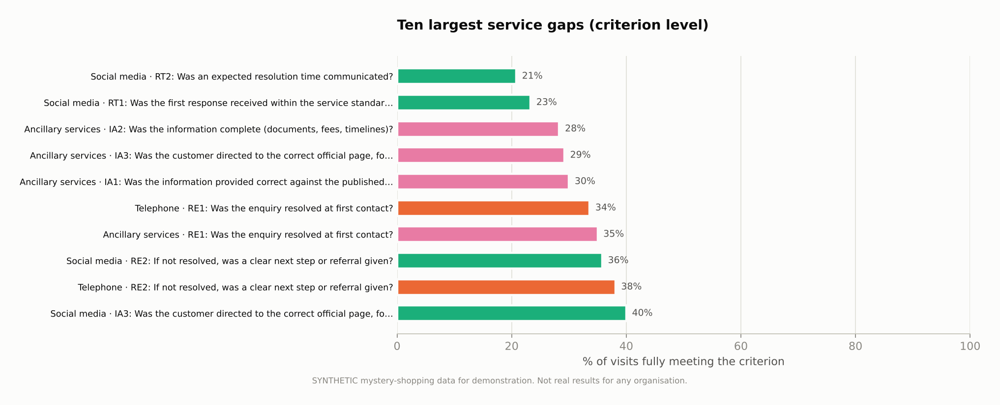
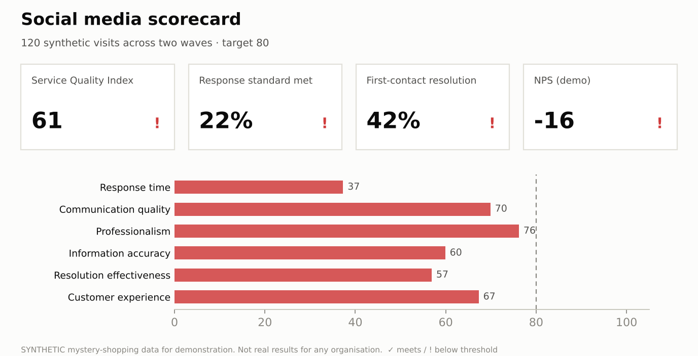

# Mystery Shopping & Service Quality Evaluation: UAE Judicial Services (Anonymised Demonstration)

A complete mystery-shopping and customer-experience research project for a public-facing **judicial services entity**. It covers five interaction channels (**email, telephone, social media, registry and ancillary services**) and includes the evaluation framework, questionnaires, data cleaning, scoring, analysis, scorecards, a Power BI-ready data model and a generated **Mystery Shopper Evaluation Report (PDF)**.

> **⚠️ Confidentiality and data notice**
> - This is an **anonymised, independent demonstration** of mystery-shopping and service-quality research methods, rebuilt from scratch.
> - **All observations, scores, response times, comments and findings are synthetic.** They were generated by code ([`generate.py`](src/mystery_shopping/generate.py)) from documented assumptions ([`docs/synthetic_data_design.md`](docs/synthetic_data_design.md)).
> - It contains **no** client records, customer information, internal reports, emails, social-media messages, telephone recordings or private findings.
> - It is **not** an official publication of, authorised deliverable for, or endorsed by any court or judicial authority. "The entity" is hypothetical, and no real organisation's performance is described.



## Objectives

1. Design a structured mystery-shopping framework covering remote and in-person channels.
2. Build channel-specific questionnaires and criteria for the registry and ancillary services.
3. Score six service-quality dimensions: response time, communication quality, professionalism, information accuracy, resolution effectiveness and customer experience.
4. Analyse channel performance, compare the registry with ancillary services, and identify service gaps and consistency issues.
5. Demonstrate an NPS-style indicator, produce scorecards and dashboards, and write an evaluation report with recommendations.

## Deliverables

| Deliverable | Location |
|---|---|
| Evaluation framework (channels, dimensions, weights, scoring, ethics) | [`docs/evaluation_framework.md`](docs/evaluation_framework.md), [`framework.py`](src/mystery_shopping/framework.py) |
| Questionnaire templates: email, telephone, social media, registry, ancillary | [`questionnaires/`](questionnaires/) (Excel with 0/1/2 drop-downs, plus Markdown) |
| Synthetic dataset (raw with injected errors, clean and scored) | [`data/raw/`](data/raw/), [`data/processed/`](data/processed/) |
| Cleaning and validation with an audit log | [`clean_score.py`](src/mystery_shopping/clean_score.py), [`cleaning_log.csv`](data/processed/cleaning_log.csv) |
| Channel-wise performance, registry vs ancillary, consistency, gaps, NPS demo | [`analysis.py`](src/mystery_shopping/analysis.py), [`outputs/tables/`](outputs/tables/) (11 CSVs) |
| Service-quality scorecards | [`outputs/scorecards/`](outputs/scorecards/) (5 PNGs), [`service_quality_scorecard.xlsx`](outputs/tables/service_quality_scorecard.xlsx) |
| Charts | [`outputs/figures/`](outputs/figures/) (9 PNGs) |
| Power BI-ready star schema and DAX measures (optional dashboard) | [`powerbi/`](powerbi/) |
| Final analytical report | [`reports/mystery_shopper_evaluation_report.pdf`](reports/mystery_shopper_evaluation_report.pdf) ([Markdown](reports/mystery_shopper_evaluation_report.md)) |

## Technology stack

Python 3.11+ · pandas · NumPy · SciPy · Matplotlib · openpyxl (Excel templates and scorecards) · ReportLab (PDF) · pytest · Power BI (optional, via the CSV star schema)

## Folder structure

```
├── run_pipeline.py                 # generate → clean & score → analyse → deliverables → report
├── src/mystery_shopping/
│   ├── framework.py                # channels, dimensions, weights, criteria, standards
│   ├── generate.py                 # synthetic observations + injected data-quality errors
│   ├── clean_score.py              # cleaning rules, validation, dimension scores, SQI
│   ├── analysis.py                 # statistics, charts, scorecards
│   ├── deliverables.py             # questionnaires (Excel/MD), Excel scorecard, Power BI tables
│   └── report.py, report_render.py # report content → Markdown + PDF
├── questionnaires/  data/  outputs/  powerbi/  reports/  docs/
└── tests/test_mystery_shopping.py  # 8 tests
```

## Installation and running

```bash
python -m venv .venv && source .venv/bin/activate      # Windows: .venv\Scripts\activate
pip install -r requirements.txt
python run_pipeline.py        # rebuilds data, outputs, questionnaires, Power BI tables and the PDF report
python -m pytest -q           # 8 tests
```

## Results (synthetic demonstration)

| Channel | SQI (0-100) | Response standard met | First-contact resolution | NPS (demo) |
|---|---|---|---|---|
| Registry | 83 | 81% | 61% | +59 |
| Email | 80 | 71% | 54% | +45 |
| Telephone | 71 | 61% | 34% | +28 |
| Ancillary services | 64 | 60% | 35% | +1 |
| Social media | 61 | 22% | 42% | −16 |
| **All channels** | **72** (target 80) | 59% | 45% | +23 |

- The registry outperforms ancillary services on every dimension (SQI gap 20 points, p < 0.001). The largest gap is information accuracy (80 vs 47).
- Social media's response time (37/100) and ancillary services' information accuracy (47/100) are the biggest service gaps.
- Every channel improves from Wave 1 to Wave 2, but no change is statistically significant. The calibration check flags one lenient and one strict assessor.

These patterns were **built into the synthetic generator on purpose**, so the analysis can be checked against known answers. They are not findings about any real organisation.

| | |
|---|---|
|  |  |
|  |  |

## Limitations

- Synthetic data only. The service standards, weights and effect sizes are illustrative assumptions.
- The likelihood-to-recommend score comes from trained assessors: it is a proxy, not a customer NPS.
- About 60 visits per channel per wave can detect SQI differences of roughly 6-8 points, so smaller changes need more visits.
- A real programme would also need client-agreed standards, assessor training records and evidence storage, and would combine mystery shopping with real customer feedback and operational data.

## Licence

MIT, see [LICENSE](LICENSE). Synthetic data and templates are released under the same licence.
