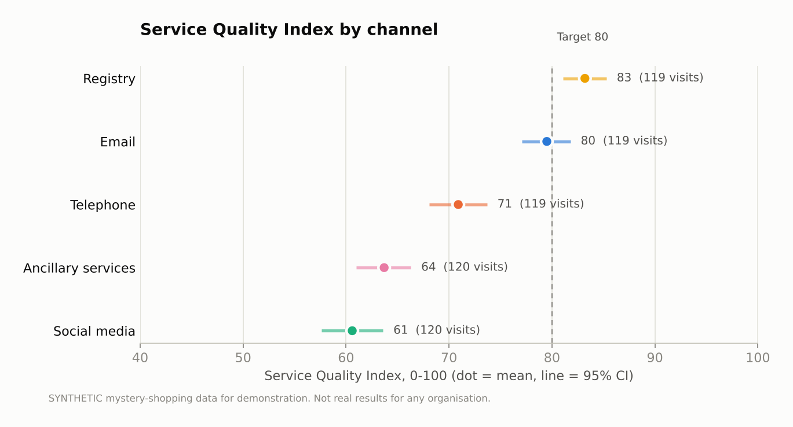
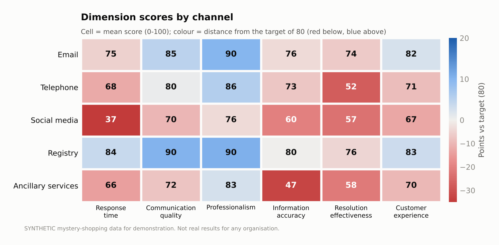
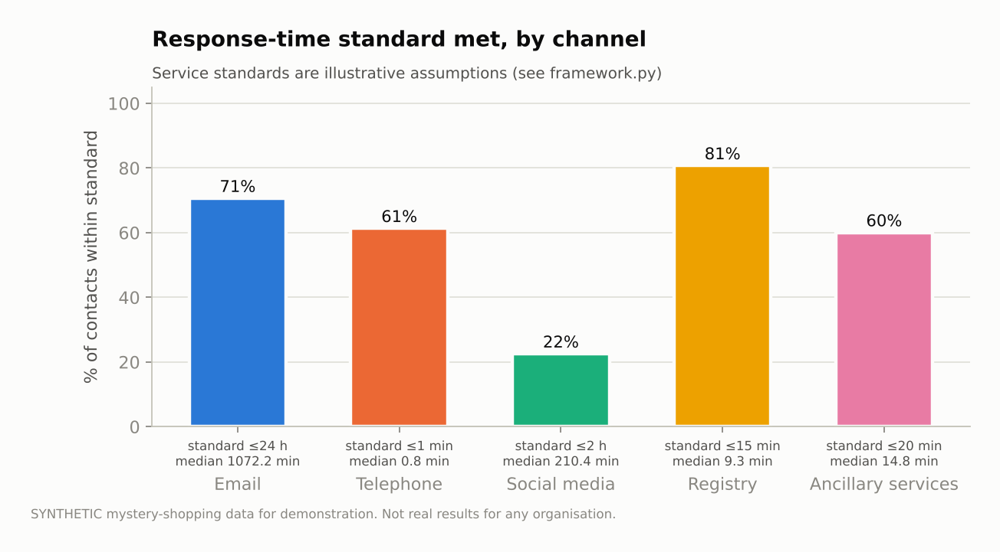
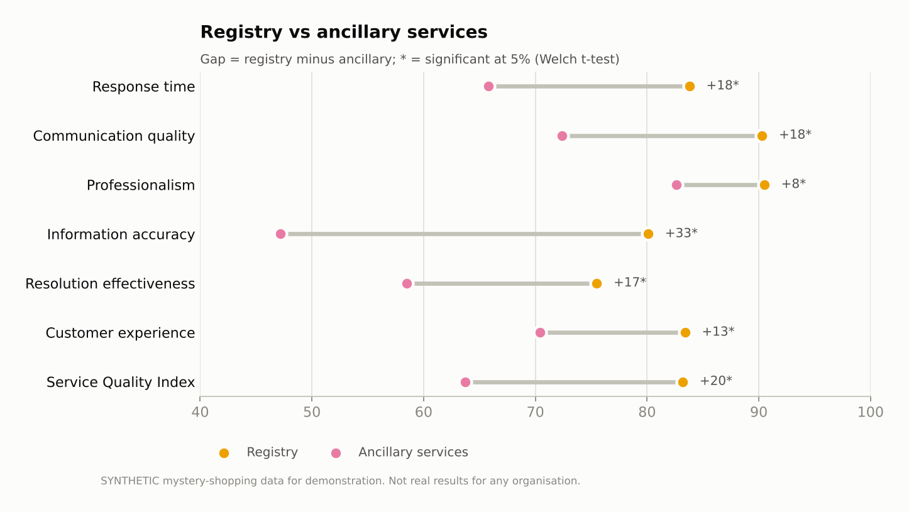
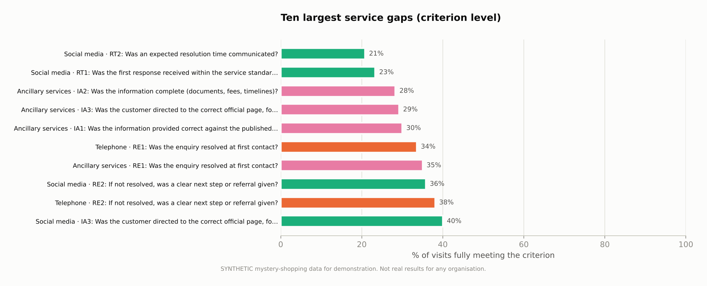
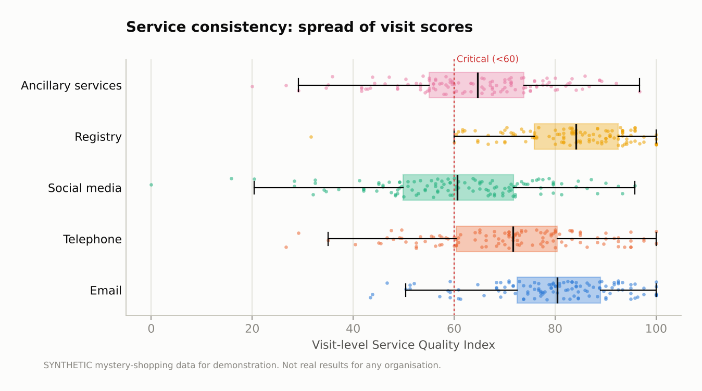
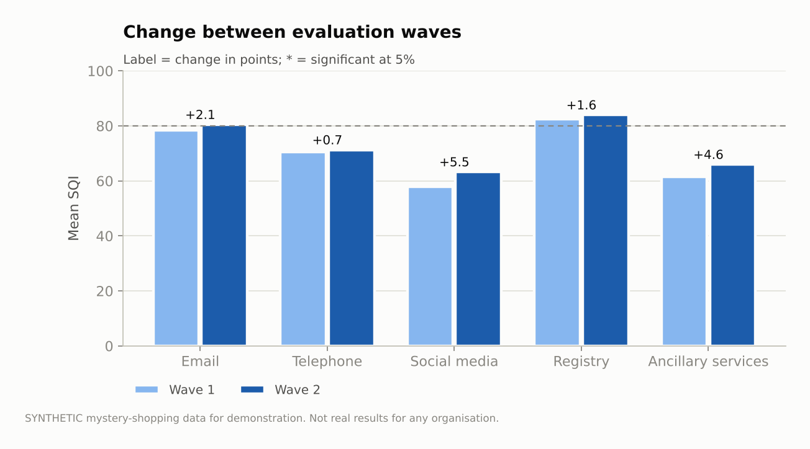
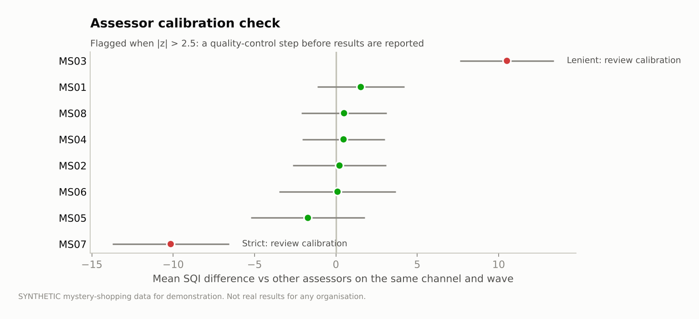
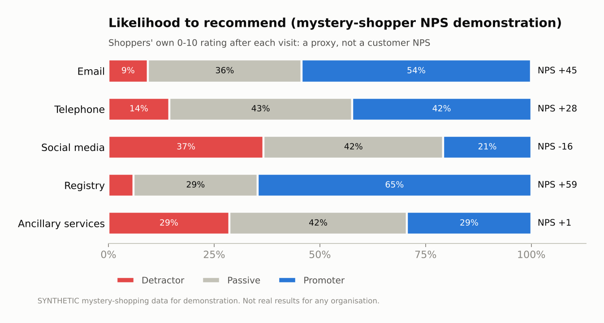

# Mystery Shopper Evaluation Report: Judicial Services Customer Experience
*Anonymised, independent demonstration of mystery-shopping and service-quality research methods (synthetic data)*

Generated 21 November 2026 by `run_pipeline.py`.

## 1. Executive summary

**All data in this report is synthetic.** It was generated by code in this repository to demonstrate mystery-shopping and customer-experience research methods. It does not describe any real court, judicial entity, staff member, customer, visit, recording or finding, and it is not an official or authorised client deliverable. 'The entity' refers to a hypothetical UAE judicial services provider.

- 597 mystery-shopping evaluations across five channels and two waves give an overall Service Quality Index (SQI) of **72/100** (95% CI 70-73), against a target of 80. 34% of visits met the target.
- **Registry** performs best (SQI 83) and **Social media** weakest (61). Only Registry meets the target on average.
- Registry outperforms ancillary services by 20 points (p < 0.001). The largest gap is in information accuracy (80 vs 47).
- Response standards are met least often on social media (22% of contacts) and ancillary services (60%).
- Across channels, the weakest dimensions are resolution effectiveness (63) and response time (66). First-contact resolution averages 45%.
- Consistency: 25% of visits scored below 60 (critical), and variability is highest on social media (coefficient of variation 28%). Wave-to-wave changes are positive on every channel, but none is statistically significant.
- Quality control flagged 2 assessor(s) (MS03, MS07) as scoring out of line with peers. Their scores should be re-calibrated before final reporting.

## 2. Objectives and scope

- Evaluate service delivery across email, telephone, social media, the registry counter and ancillary services (translation, notarisation, mediation information, visitor support).
- Score six service-quality dimensions: response time, communication quality, professionalism, information accuracy, resolution effectiveness and customer experience.
- Compare channels and the registry against ancillary services, identify service gaps and consistency issues, and recommend improvements.

## 3. Methodology

- **Design:** trained mystery shoppers carry out scripted, realistic scenarios per channel (e.g. fee enquiries, document submission, hearing-date questions), spread across weekdays, mornings and afternoons, in two waves six months apart.
- **Questionnaires:** 17 criteria, scored 2 (fully met), 1 (partly met) or 0 (not met). Each channel uses the criteria that apply to it (templates in questionnaires/). Response time is measured objectively against illustrative channel standards.
- **Scoring:** dimension score = mean criterion score rescaled to 0-100. SQI = weighted mean of the dimensions (information accuracy 25%, resolution 20%, and 15% each for response time, communication and professionalism, 10% customer experience).
- **Analysis:** means with 95% confidence intervals, Welch t-tests for registry vs ancillary and wave changes, coefficient of variation and share of critical visits for consistency, an assessor calibration check (residual z-scores), and a likelihood-to-recommend NPS as a proxy measure.
- **Data quality:** 606 raw rows were cleaned to 597 valid visits using logged rules (duplicates, channel spellings, invalid scores, missing assessor IDs, date formats).

## 4. Channel performance

| Channel | Visits | SQI | CI low | CI high | ≥ target % | Resp. std % | FCR % | NPS (demo) |
|---|---|---|---|---|---|---|---|---|
| Email | 119 | 79.5 | 77.1 | 81.8 | 52.1 | 70.6 | 53.8 | 44.9 |
| Telephone | 119 | 70.9 | 68.1 | 73.7 | 28.6 | 61.3 | 33.6 | 28.0 |
| Social media | 120 | 60.6 | 57.6 | 63.6 | 9.2 | 22.5 | 41.7 | -15.8 |
| Registry | 119 | 83.2 | 81.1 | 85.3 | 68.9 | 80.7 | 61.3 | 58.8 |
| Ancillary services | 120 | 63.7 | 61.0 | 66.3 | 13.3 | 60.0 | 35.0 | 0.8 |
| All channels | 597 | 71.5 | 70.2 | 72.9 | 34.3 | 59.0 | 45.1 | 23.2 |

Dimension scores more than 10 points below target: Social media / response time (37); Ancillary services / information accuracy (47); Telephone / resolution effectiveness (52); Social media / resolution effectiveness (57); Ancillary services / resolution effectiveness (58); Social media / information accuracy (60); Ancillary services / response time (66); Social media / customer experience (67).

## 5. Registry vs ancillary services

| Measure | Registry | Ancillary | Gap | Effect size (d) | p | Sig. |
|---|---|---|---|---|---|---|
| Response time | 83.8 | 65.8 | 18.0 | 0.68 | 0.0 | yes |
| Communication quality | 90.3 | 72.4 | 18.0 | 0.93 | 0.0 | yes |
| Professionalism | 90.5 | 82.6 | 7.8 | 0.44 | 0.0009 | yes |
| Information accuracy | 80.1 | 47.2 | 32.9 | 1.5 | 0.0 | yes |
| Resolution effectiveness | 75.5 | 58.5 | 17.0 | 0.7 | 0.0 | yes |
| Customer experience | 83.4 | 70.4 | 13.0 | 0.54 | 0.0 | yes |
| Service Quality Index | 83.2 | 63.7 | 19.5 | 1.48 | 0.0 | yes |

Every dimension favours the registry. The information-accuracy gap is large (effect size d = 1.5), which suggests ancillary staff lack an up-to-date reference for procedures and fees rather than a courtesy problem: professionalism shows the smallest gap.

## 6. Service gaps and consistency

| Channel | SD | CV % | Critical (<60) % |
|---|---|---|---|
| Email | 13.0 | 16.4 | 10.1 |
| Telephone | 15.3 | 21.6 | 22.7 |
| Social media | 16.7 | 27.5 | 47.5 |
| Registry | 11.5 | 13.9 | 0.8 |
| Ancillary services | 14.6 | 22.9 | 41.7 |
| All channels | 16.8 | 23.4 | 24.6 |

| Channel | Wave 1 | Wave 2 | Change | p | Sig. |
|---|---|---|---|---|---|
| Email | 78.4 | 80.5 | 2.1 | 0.3864 | no |
| Telephone | 70.6 | 71.3 | 0.7 | 0.8061 | no |
| Social media | 57.8 | 63.3 | 5.5 | 0.0702 | no |
| Registry | 82.4 | 84.0 | 1.6 | 0.4554 | no |
| Ancillary services | 61.4 | 66.0 | 4.6 | 0.0824 | no |

Afternoon visits score lower than morning visits on average (significant, p = 0.037). This points to staffing or fatigue effects worth checking against queue data.

## 7. Likelihood to recommend (NPS demonstration)

Shoppers rated how likely they would be to recommend the service after each visit. Because the raters are trained assessors, this is a proxy indicator that tracks the SQI. It is not a substitute for a real customer NPS, which should be collected from actual service users.

## 8. Recommendations

- **Resolution effectiveness (cross-channel score 63):** Empower front-line staff to resolve common requests at first contact and define warm-transfer / referral paths with call-backs.
- **Response time (cross-channel score 66):** Set and publish channel service standards (e.g. social media first reply within 2 hours); add queue monitoring and staffing rules for peak periods.
- **Information accuracy (cross-channel score 67):** Create a single, version-controlled knowledge base of procedures, fees and document lists that all channels use; retrain on high-error scenarios.
- **Prioritise social media:** it has the lowest SQI and the most critical visits. Assign an owner and track a monthly target.
- **Close the registry-ancillary gap:** give ancillary services the same knowledge base, scripts and supervision as the registry.
- **Improve consistency:** publish service standards per channel, run monthly call and visit sampling, and coach staff on the lowest-scoring criteria.
- **Strengthen the programme:** re-calibrate flagged assessors, keep scenarios identical between waves, and add a real customer-feedback survey.

## 9. Limitations

- All observations are synthetic and generated from documented assumptions (docs/synthetic_data_design.md). Patterns such as the registry outperforming ancillary services were built in on purpose to demonstrate the analysis.
- Service standards and dimension weights are illustrative choices. A real programme would agree them with the client.
- About 60 visits per channel per wave can detect gaps of roughly 6-8 SQI points. Smaller wave-to-wave changes need more visits or a longer time series.
- Mystery shopping measures a scripted experience. It should be combined with real customer feedback and operational data.

## Appendix: cleaning log

| Rule | Rows | Action |
|---|---|---|
| Rows in raw file | 606 | - |
| Exact duplicate rows | 6 | dropped |
| Repeated visit_id | 0 | dropped, first kept |
| Channel spelling variants standardised | 30 | recoded |
| Unrecognised channel | 0 | dropped |
| Missing shopper_id | 3 | dropped (assessor must be traceable) |
| Invalid criterion scores (not 0/1/2) | 11 | set to missing (cell-level) |
| Response time missing, negative or text | 6 | set to missing; RT1 left as recorded |
| Visit date in dd/mm/yyyy format | 9 | converted to ISO |
| Likelihood-to-recommend missing or outside 0-10 | 3 | set to missing, excluded from NPS only |
| Rows in clean dataset | 597 | - |
